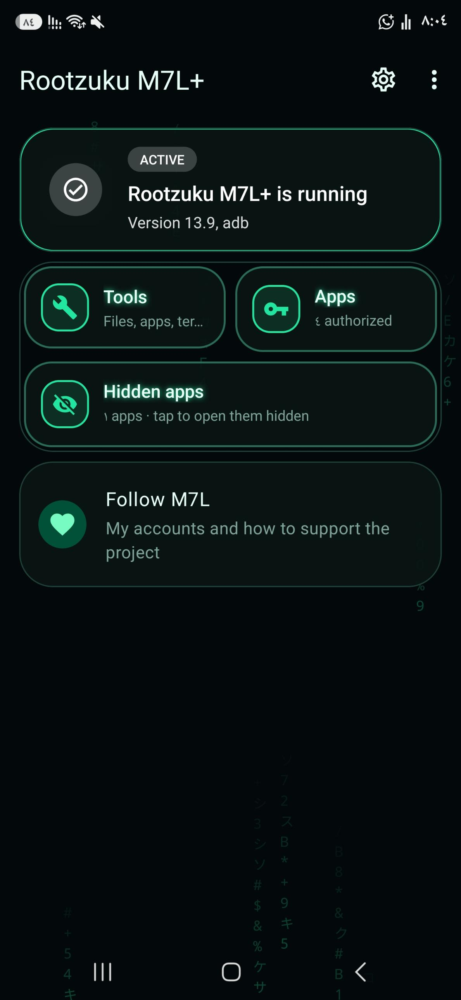
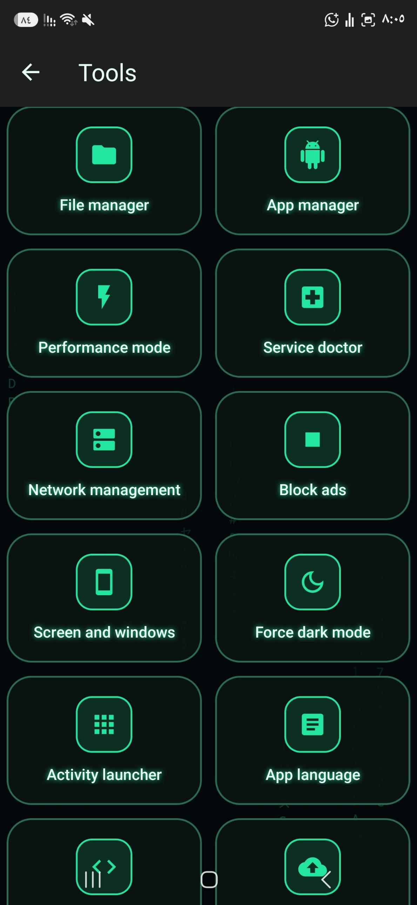
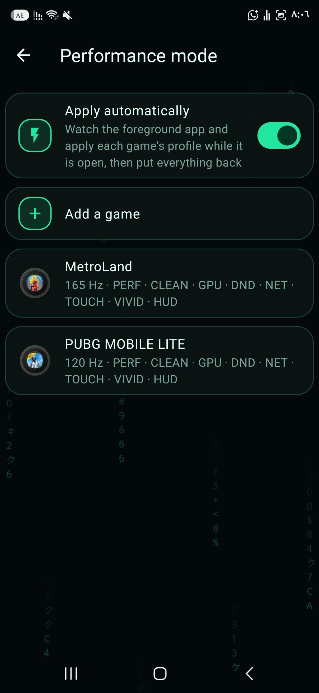
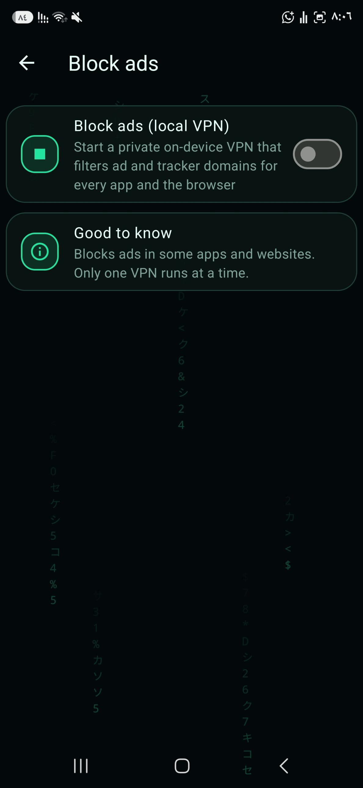

<div align="center">

# ⚡ Rootzuku M7L+

**A powerful no‑root ADB privilege manager for Android — a heavily extended Shizuku build with a per‑game booster, a local ad‑blocker and dozens of system tools.**


### [](https://github.com/m7ldev/Shizuku-Rootzuku-M7L/releases/latest)

   

</div>

---

## 📖 About

**Rootzuku M7L+** is an extended build of the open‑source **[Shizuku](https://github.com/RikkaApps/Shizuku)** project. It grants apps system‑level (ADB / shell) privileges **without root**, started over wireless debugging, USB, or a computer.

On top of the original core it adds **dozens of tools** aimed at gamers and power users — a per‑game performance booster, a local VPN ad‑blocker, a **stealth mode** that hides developer options from apps which detect them, app and file managers, and a full set of network, display and developer utilities — all in a clean neon UI.

| Package | `com.m7l.shizuku` |
|---|---|
| Version | 13.9 |
| Based on | [Shizuku](https://github.com/RikkaApps/Shizuku) by RikkaApps |
| Root | Not required |

---

## ✨ Features

### 🚀 Activation
- Start via **Wireless debugging** (in‑app pairing, Android 11+).
- Start via **USB with no Wi‑Fi** — opens the classic ADB port (5555) with a `tcpip` request, then connects locally.
- Start via a **computer** (ADB command).
- **Quick Settings tile** + start on boot.

### 🎮 Performance Mode — game booster
- A **per‑game profile**, applied automatically when the game opens and reverted when you leave.
- Force **refresh rate** (up to 165 Hz), performance mode, background cleanup, forced GPU rendering.
- **Vivid colours** and **touch sensitivity** (Samsung), Do Not Disturb, keep the network for the game.
- A **floating performance meter** (FPS / CPU / RAM / temperature / ping) per game.

### 🛡️ Block Ads
- A **local on‑device VPN** that filters ad and tracker domains (90+ ad networks) for every app and the browser.
- No root, fully local filtering — no data sent to any server.

### 📱 App Manager
- Freeze, force stop, close in background, standby bucket, background activity.
- Permissions, clear data, uninstall (even system apps for the user), **ignore battery optimisation**.
- Debloat preinstalled apps + restore.

### 🌐 Network Management
- **Private DNS**, fastest‑DNS benchmark, connection test.
- **Data saver** and per‑app background‑data blocking.
- Refresh the connection, and a full **reset of network settings**.

### 🖥️ Screen & Windows
- **Protected‑app screenshot** — a floating button using `screencap` that captures even apps that block screenshots.
- **Force 120 Hz**, screen density (DPI), resizable & freeform windows, animation speed.
- **Rotation lock** (force portrait / landscape).

### 🧰 Developer Tweaks
- Stay awake while charging, show taps, pointer location.
- Keep mobile data active, disable Wi‑Fi scan throttling.
- Immersive full screen, turn off all animations, toggle location.

### 🕵️ Stealth Mode — bypass developer‑options detection
- Protection for apps that **refuse to run when Developer options / USB debugging are on** (banking apps, protected games, some payment apps).
- Pick those apps once. When you open one through Stealth, it **automatically turns off Developer options, USB debugging and wireless debugging** so the app sees a clean device.
- It watches for you leaving the app, then **restores the settings and restarts the service** on its own.
- No root — done through the already‑running ADB service. *(Re‑starting the service afterwards uses wireless debugging, so keep Wi‑Fi on.)*

### 🔧 More Tools
- Dual‑pane **File manager**.
- **Activity launcher** (open any screen inside any app) + favorites.
- **Per‑app language** (shows each app's current language).
- **Force dark mode** for the whole system or per app.
- **Service doctor**, **Terminal**, **Logs**, **Backup & restore**.

---

## 📲 How to use

1. Install the app and allow **notifications**.
2. Start the service: **Wireless debugging** (pair in‑app), **USB**, or from a **computer** — see the in‑app step‑by‑step guide.
3. Open **Tools** and use any utility; authorize other apps from **Apps**.

## 📱 Requirements

- **Android 7.0+** (API 24).
- No root. Android 11+ unlocks in‑app wireless start.

---

## 🧩 Build from source

| | |
|---|---|
| Package | `com.m7l.shizuku` |
| compileSdk / minSdk / targetSdk | 36 / 24 / 36 |
| Java | 21 |

```bash
# Requires JDK 21 and the Android SDK (NDK + CMake)
./gradlew :manager:assembleDebug
# Output: manager/build/outputs/apk/debug/*.apk
```

Custom tools live in `manager/src/main/java/moe/shizuku/manager/tools/`.

---

## 🔗 Source & credits

Built on **Shizuku**. The original core is © **RikkaApps** and is used under its license.

| Project | Source |
|---|---|
| Shizuku (core) | [RikkaApps/Shizuku](https://github.com/RikkaApps/Shizuku) |

---

## 👤 Developer

<div align="center">

### M7L TEAM
**Developed and designed by M7L TEAM**

[](https://youtube.com/@androidplus4494)
[](https://www.instagram.com/m7l.misoz)
[](https://t.me/m7lmisoz)
[](https://x.com/m7lmisoz)
[](https://www.paypal.com/paypalme/hakrm7l)

</div>

---

## ©️ Rights

**© 2026 M7L TEAM — Rootzuku M7L+**

Extensions, design and the Rootzuku name by **M7L TEAM**.
Built on **Shizuku** — the original core is © **RikkaApps** and remains under its own license.

<div align="center">

⭐ If you like the project, don't forget to star it ⭐

</div>
